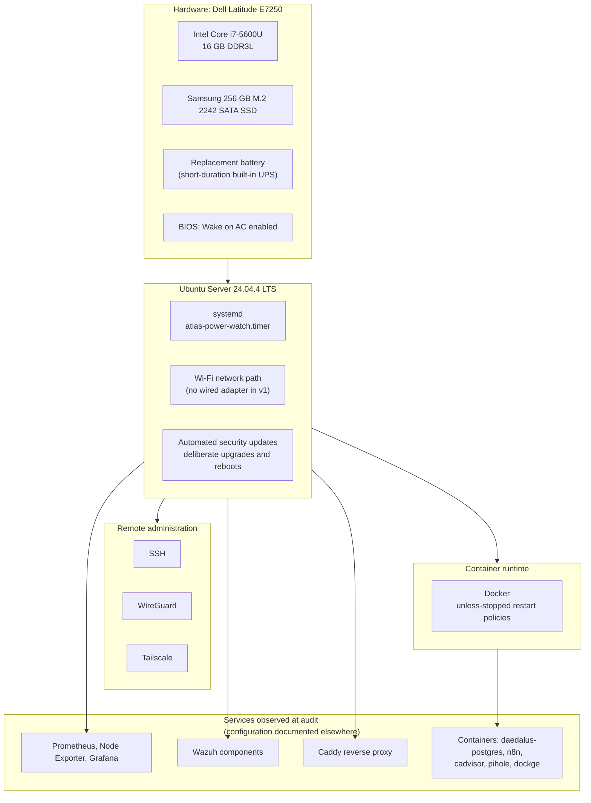
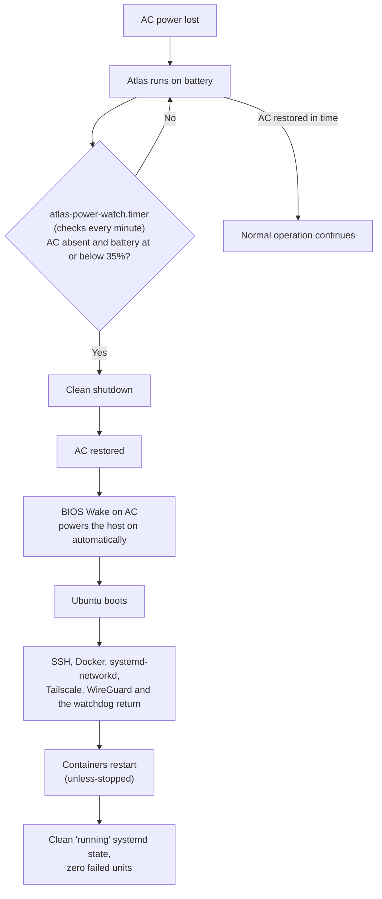

# Atlas v1 Architecture

This document describes the **host platform** of Atlas v1: the hardware, operating system, remote access, container runtime and the power-recovery behaviour that keeps the machine running unattended. It summarizes what the [README](README.md), the [project overview](docs/project-overview.md) and the [evidence](docs/evidence/) already establish.

Detailed application configuration (Nextcloud, Pi-hole, n8n and so on) and the broader COC design are deliberately out of scope here. They are documented in the [Cyber Operations Center Engineering Program](https://github.com/scott-renny/cyber-operations-center-engineering-program).

## Platform stack

| Layer | Component | Role |
|---|---|---|
| Hardware | Dell Latitude E7250, i7-5600U (2 cores / 4 threads), 16 GB DDR3L | COC infrastructure server |
| Storage | Samsung 256 GB M.2 2242 SATA SSD | System disk. A 1 TB 2280 drive was bought but does not fit the 2242 slot ([storage decision](hardware/storage-decision.md)) |
| Network | Wi-Fi only | Intentional for v1. An external wired adapter will not be added in this version |
| Operating system | Ubuntu Server 24.04.4 LTS | Host baseline |
| Remote access | SSH, WireGuard, Tailscale | Private administration. External SSH and remote-development acceptance confirmed by the owner |
| Containers | Docker | Production containers recover automatically via `unless-stopped` |
| Observability and security | Prometheus, Node Exporter, Grafana, Wazuh, Caddy | Active at the time of the audit. Inventory only; service-level design lives in the COC repository |

## Power and recovery flow

Atlas was validated for unattended operation on September 7, 2026 ([evidence](docs/evidence/atlas-v1-resilience-validation-2026-09-07.md)). The laptop battery acts as a short-duration UPS and a systemd timer protects the filesystem when the battery runs low.

A normal reboot follows the same path from "Ubuntu boots" onward, and the host returns to an administrable state.

## Maintenance policy

> Recovery is automatic, security maintenance is automatic where safe, and potentially disruptive change is deliberate.

| Change type | Handling |
|---|---|
| Ubuntu security updates | Automated |
| Application, container, OS-release and firmware changes | Deliberate |
| Reboots | Deliberate |
| Networking and power-management changes | Require a rollback path and local access, because they can interrupt remote access |

## Design decisions

- **Reuse before adding.** The resilience milestone used existing hardware (the battery) and native platform features (BIOS Wake on AC, systemd timers, Docker restart policies) rather than new tooling.
- **Keep the SSD.** The existing 256 GB drive stays in service. A larger drive will be considered only if measured usage justifies it.
- **Wi-Fi as the network path.** Accepted as a v1 limitation rather than adding a wired adapter.
- **Host platform only.** Service configuration stays with each service's own documentation, so this repository does not duplicate it.

## Known limitations

- Wi-Fi is the only network path.
- A single laptop is the single host. The battery provides short-duration backup only.
- Optional follow-up evidence is **not** reported as passed: SSD health, idle and sustained-load temperatures, cooling-stand and local-display validation, lid-close and suspend/hibernate checks, and an extended reliability test.
- Atlas v2 (2U rack replacement) is a later phase and is not described here.

## Related documents

- [README](README.md)
- [Project overview](docs/project-overview.md)
- [Atlas v1 completion record](docs/atlas-v1-completion.md)
- [Resilience validation, 2026-09-07](docs/evidence/atlas-v1-resilience-validation-2026-09-07.md)
- [Post-upgrade audit summary](docs/evidence/atlas-v1-after-audit.md)
- [Hardware notes](hardware/)
